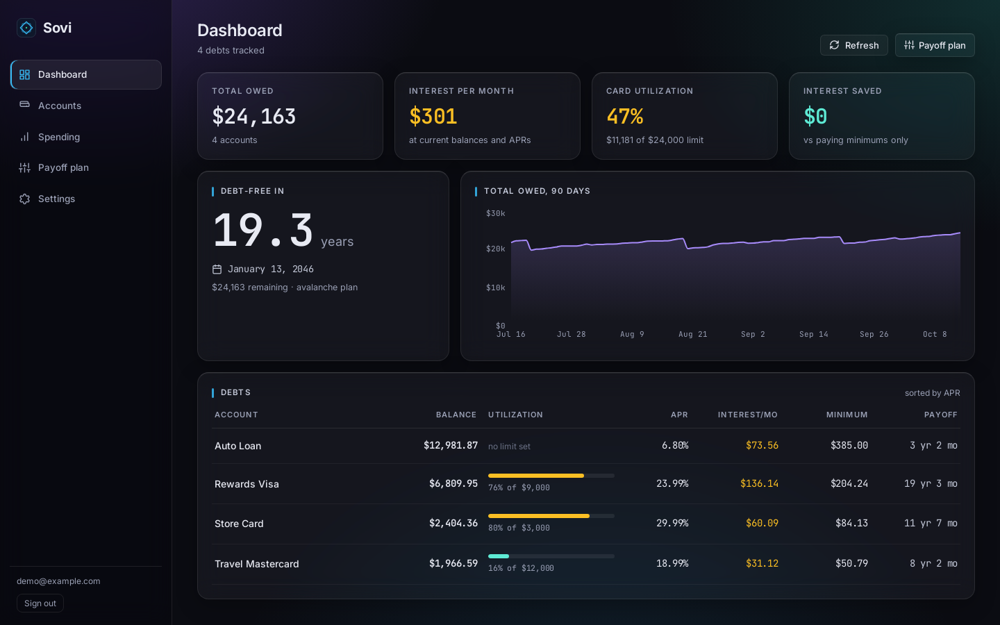
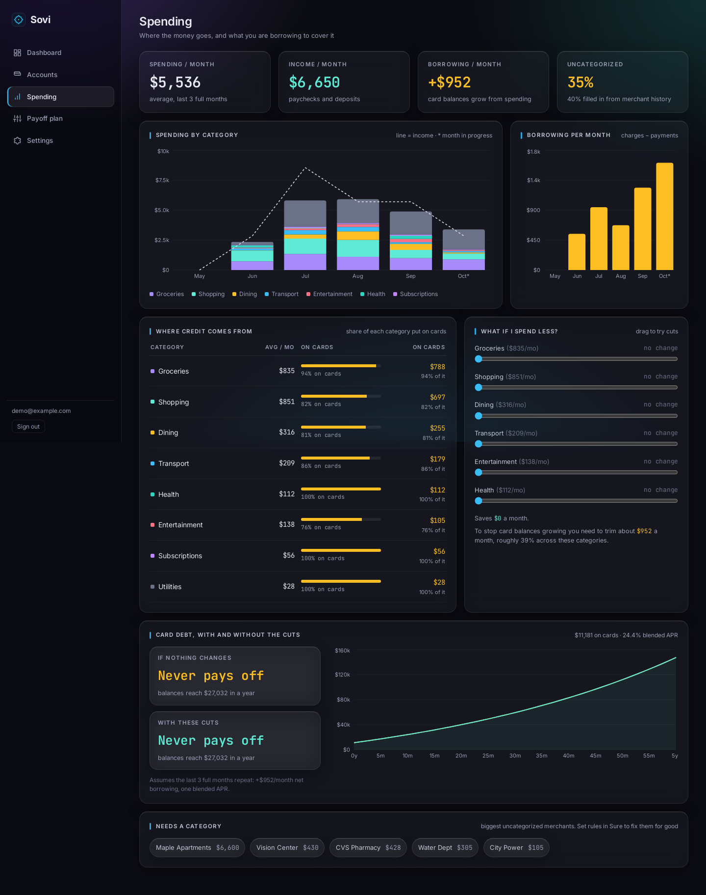
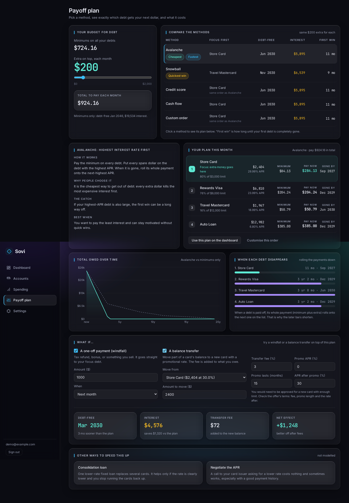
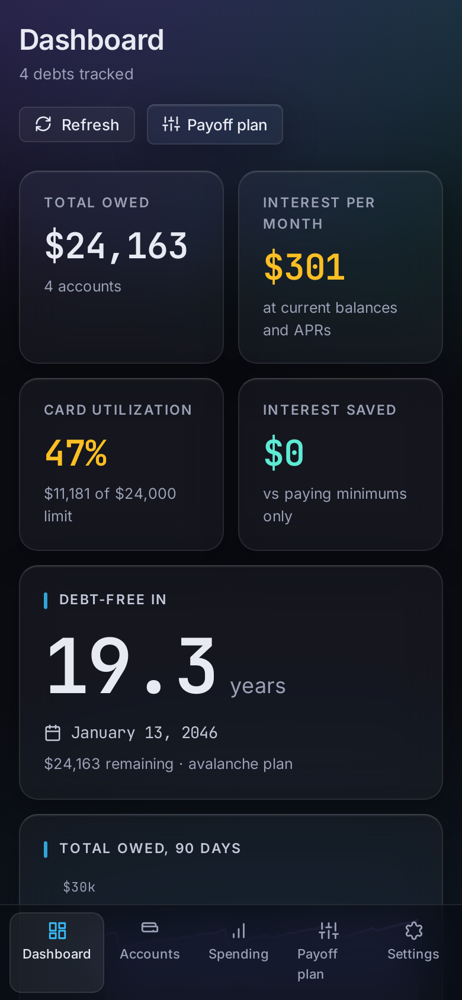
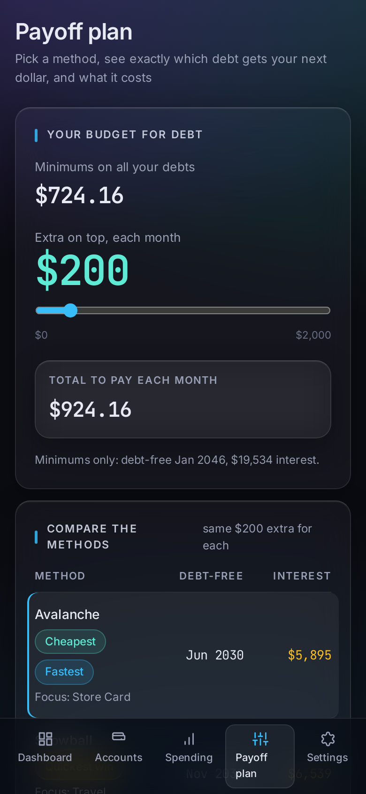

# Sovi

**Your numbers. Your stack. Your control.**

Sovi is a self-hosted debt payoff and spending tracker. It shows what you owe, which debt to attack first and when you will be free of it, and it connects your spending to the plan: how much of what you spend ends up on a credit card, and what changes if you spend less.

It runs on your own hardware, keeps your data in your own Postgres, and reads from the finance tools you already use rather than replacing them.



## What it does

- **Dashboard.** Total owed, monthly interest, card utilization, a debt-free date, 90 days of history and a debt table with balance, utilization, APR, minimum and payoff time.
- **Payoff plan.** Five strategies side by side with the same budget: *Avalanche* (highest APR first), *Snowball* (smallest balance first), *Credit score* (highest card utilization first), *Cash flow* (lowest balance-to-minimum first) and *Custom order*. Each is explained in plain English. The plan lists exactly what to pay each debt this month, which debt is the focus, and when each one disappears as payments roll down.
- **What-ifs.** Try a one-off windfall or a balance transfer (fee, promotional rate and its length) and see the debt-free date, the interest saved and the net effect after fees.
- **Spending.** Spending by category, how much of each category goes on cards, and a monthly "borrowing" figure: card charges minus refunds minus what you paid the cards. Drag category cuts and see when your card debt would clear, with and without them, and how much you need to trim just to stop it growing.
- **Accounts.** Add accounts by hand (cards, loans, assets) with APR, minimum-payment rule, credit limit and due day, or let them sync.

| Spending | Payoff plan |
|---|---|
|  |  |

It works on a phone as well as a laptop:

| | |
|---|---|
|  |  |

## Where the data comes from

| Source | What you get |
|---|---|
| **[Sure](https://github.com/we-promise/sure)** (recommended) | Accounts, daily balance history and transactions, read-only through Sure's API. Sovi stays a read-only analytics layer on top: Sure remains the place where you enter data, categorize and budget. |
| **SimpleFIN** | Direct bank sync through a SimpleFIN setup token. |
| **Manual** | Type in your cards and loans. No connection needed. |

Connect Sure in *Settings*: give it your Sure URL and a read-only API key. The key is stored encrypted and is only ever sent to your Sure server. The first sync pulls the history Sure has, then Sovi syncs a few times a day.

### Conventions worth knowing

- **Balances are signed:** assets positive, debts negative. "Amount owed" is derived in one place (`api/app/money.py`), so a source that reports debt as positive (like Sure) is normalised once, on import.
- **Transfers are never spending.** Sure flags them; Sovi excludes them from every spending figure. Card payments are the main case.
- **Categories** come from Sure. Where Sure left a transaction uncategorized, Sovi borrows the category you most often use for the same merchant, and the Spending page shows how much was filled in that way and which merchants still need a category. Sovi never writes back to Sure.

## Run it

You need Docker (or rootless Podman) with Compose.

```bash
git clone https://github.com/d3mocide/Sovi && cd Sovi

# secrets live in files, not in environment variables
mkdir -p secrets
openssl rand -hex 32 > secrets/master_key.txt     # encrypts stored credentials; back it up
openssl rand -hex 24 > secrets/db_password.txt
chmod 700 secrets && chmod 644 secrets/*.txt      # the app runs as a non-root user inside the container

cp .env.example .env
# put a random value on the SECRET_KEY line:  openssl rand -hex 32

docker compose up -d --build
```

Open the site and create the admin account on the first screen. By default the web container publishes port 80; to change that, use a compose override.

**Behind HTTPS:** put it behind a reverse proxy and keep `COOKIE_SECURE=true` (the default). Set `COOKIE_SECURE=false` only for plain-HTTP development, because browsers will not store a `Secure` cookie over HTTP.

**Back up the master key.** Sure and SimpleFIN credentials are encrypted with it. Without it they cannot be decrypted, and you would reconnect.

### Develop

```bash
# the stack with hot reload is just the compose file plus source mounts; see dev/ for a mock Sure
python dev/mock_sure.py 9000      # a fake Sure API with realistic synthetic data (key: mockkey)
```

`dev/mock_sure.py` serves the same endpoints and sign conventions as the real Sure API, with several credit cards, a loan, 120 days of transactions, merchants, categories and transfers. Point *Settings → Sure connection* at it to try everything without any real financial data. The screenshots above were made that way.

Tests:

```bash
# API: mapping and client tests
docker compose exec api python -m pytest tests

# payoff engine (TypeScript): strategies, minimums, windfalls, promo rates
cd shared/payoff && npm ci && npm test
```

On rootless Podman the secret files must be readable by the container user (the `chmod 644` above), because Podman maps files owned by you to root inside the container.

## How it is built

| Part | What |
|---|---|
| `frontend/` | React, TypeScript, Vite, Recharts. One stylesheet of design tokens (`src/styles/tokens`), a glass-panel layout (`src/styles/layout.css`), responsive from phone to laptop. |
| `api/` | FastAPI, asyncpg, Alembic migrations. Argon2id passwords, optional TOTP, CSRF double-submit cookie, per-user data keys wrapped by the master key (AES-GCM). |
| `worker/` | `arq` jobs: scheduled syncs for Sure and SimpleFIN. |
| `shared/payoff/` | The payoff engine in TypeScript (used by the browser for instant what-ifs), mirrored by `api/app/payoff/` for server-side numbers. |
| Postgres 16, Redis 7 | Data and job queue. |

Dependencies are pinned to exact versions and held for 72 hours before adoption; see [DEPENDENCIES.md](DEPENDENCIES.md).

## Status

Sovi is a young project that one person uses and is actively developing.

Working: the dashboard, payoff plan with five methods, windfall and balance-transfer what-ifs, spending analysis, the Sure source, SimpleFIN, manual accounts, login with optional TOTP.

Not yet: saving what-ifs with a plan, a net-worth view, writing category suggestions back to Sure, and a published license (all rights reserved until one is added).

## Design

The brand guidelines, logo and tokens are in [`brand/`](brand/). The look is a graphite base with soft glows and frosted-glass panels; blue marks navigation and focus, mint means progress, violet carries chart data and amber means "look at this".
